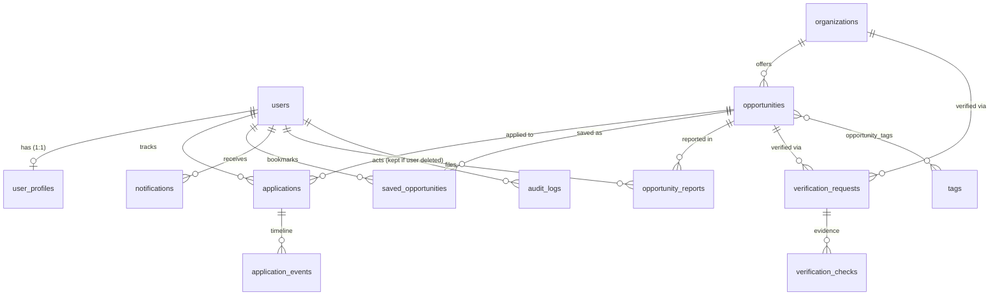

# LaunchByte — Database Guide

PostgreSQL (Supabase) via SQLAlchemy 2.0 + Alembic. **19 tables** in five groups.
Models live in `app/models/`, migrations in `alembic/versions/`.

## Entity-relationship diagram



## Tables at a glance

| Group | Table | Purpose |
|---|---|---|
| Identity | `users` | Accounts, credentials, role, `token_version`. **Extended** with `role`, `is_email_verified`, `last_login_at`, `updated_at`. |
| | `user_profiles` | Optional seeker details (education, skills, links). 1:1 with `users`. |
| | `email_verification_tokens` | Single-use 24h tokens (hashed at rest with SHA-256) for email verification. |
| | `password_reset_tokens` | Single-use 1h tokens (hashed at rest with SHA-256) for password reset. |
| Catalog | `organizations` | Who offers opportunities (company, university, NGO, ...). Has a verification state. |
| | `organization_members` | Membership of users in organizations (`role`: owner, editor). |
| | `opportunities` | The postings: type, lifecycle status, dates, compensation, trust score. |
| | `tags` / `opportunity_tags` | Free-form labels, many-to-many. |
| | `saved_opportunities` | Lightweight bookmarks. |
| Tracker | `applications` | A user's tracked application. Works for platform *and* external opportunities. |
| | `application_events` | Append-only timeline: status changes, notes, interviews. |
| Trust | `verification_requests` | "Please verify this organization / opportunity." |
| | `verification_checks` | The individual signals behind a decision (domain match, registry, manual...). |
| | `opportunity_reports` | Seekers flagging scams / expired / misleading postings. |
| Platform | `notifications` | In-app messages (deadline reminders, status updates). |
| | `audit_logs` | Append-only record of staff/sensitive actions. |
| | `media_assets` | Media uploads tracking (uploaded_by, url, dimensions, size_bytes). |
| | `site_team_members` | Public team roster displayed on About page. |

## How "verification surfacing" works

```
verification_requests ──has many──▶ verification_checks   (the evidence)
        │ reviewer decision
        ▼
organizations.verification_status
opportunities.verification_status + trust_score + verified_at   ◀── what the API shows seekers
opportunity_reports (open reports can flip an opportunity to `flagged`)
audit_logs  ◀── every decision is recorded
```

`verification_status` and `trust_score` are **denormalized onto the opportunity** on purpose: the browse
page needs them on every row, and joining checks for every listing would be wasteful. The service that
records a decision must update both places in one transaction.

## Rules the database enforces (not just the app)

| Rule | Mechanism |
|---|---|
| Enum columns only hold valid values | `VARCHAR` + named `CHECK` (`ck_<table>_<column>`) |
| One account per email | unique index on `users.email` (service also lowercases it) |
| One tracked application per user per opportunity | `UNIQUE (user_id, opportunity_id)` |
| An application must point at *something* | `CHECK opportunity_id IS NOT NULL OR custom_title IS NOT NULL` |
| A verification request targets exactly one subject | `CHECK` (org XOR opportunity) |
| A user can report a posting for a given reason once | `UNIQUE (opportunity_id, reporter_id, reason)` |
| Sane ranges | `trust_score` 0-100, `priority` 1-3, `compensation_min <= max`, `starts_at <= ends_at`, `graduation_year` 1950-2100 |
| Can't delete an organization that has postings | `opportunities.organization_id` → `ON DELETE RESTRICT` |
| Can't delete an opportunity people applied to | `applications.opportunity_id` → `ON DELETE RESTRICT` (soft-delete instead: `deleted_at`) |
| Deleting a user removes their personal data | `ON DELETE CASCADE` → profile, applications (+events), bookmarks, notifications |
| Deleting a user keeps shared/moderation records | `ON DELETE SET NULL` → reports, audit logs, verification requests, posted opportunities |

## Conventions

- **UUID primary keys** everywhere (matches the existing `users.id`).
- **`created_at` / `updated_at`** are `timestamptz`, defaulted by the database (`now()`).
  `updated_at` is bumped by SQLAlchemy on ORM updates — raw SQL updates must set it manually.
- **Soft delete** (`deleted_at`) on `organizations` and `opportunities`. **Every list query must filter
  `deleted_at IS NULL`** — the database will not do it for you.
- **Ownership:** every query on `applications`, `saved_opportunities`, `notifications` must filter by the
  current user's id (`CurrentUser` in `app/dependencies/auth.py`). This is the app's authorization boundary.
- **JSON** columns are `JSONB` on Postgres. Use them for flexible lists/blobs, not for anything you filter on.
- **Emails** are stored lowercase and compared case-insensitively.

## Day-to-day commands

```bash
cd backend
alembic upgrade head                 # create / update the schema
python -m app.db.seed                # dev demo data (idempotent; refuses when ENV=production)
alembic check                        # fails if models and migrations have drifted
pytest                               # 56 tests; no Postgres required
```

### Changing the schema

1. Edit or add a model in `app/models/` (new file → import it in `app/models/__init__.py`).
2. `alembic revision --autogenerate -m "short description"`
3. **Read the generated file.** Autogenerate cannot see CHECK constraints or enum changes, and renames look
   like drop + add.
4. `alembic upgrade head` on a scratch database, then `alembic check` → "No new upgrade operations detected".
5. `pytest` — `tests/test_migrations.py` fails if models and migrations disagree.

**Adding an enum value** (e.g. a new `OpportunityType`): add it to `app/models/enums.py`, then write a
migration that drops and recreates that column's CHECK:

```python
op.drop_constraint("ck_opportunities_type", "opportunities", type_="check")
op.create_check_constraint("ck_opportunities_type", "opportunities", "type IN ('internship', ..., 'newvalue')")
```

## Supabase notes

- Set `DATABASE_URL` to the connection string from *Dashboard → Connect*, keeping the `postgresql+psycopg2://`
  prefix. URL-encode special characters in the password.
- Run **migrations over a direct or session-mode connection**, not the transaction pooler.
- **Run `docs/supabase_rls.sql` once.** Supabase exposes `public` tables through a public REST API by default;
  this script locks that door (the backend is unaffected). Re-run it after adding tables.
- Back up before migrating anything containing real data (Supabase → Database → Backups).

## Known limits (fine for small scale, revisit later)

- No full-text / fuzzy search yet — add a `tsvector` column + GIN index (or `pg_trgm`) when keyword search is built.
- No email-verification or password-reset token tables — `is_email_verified` exists but nothing sets it yet.
- `view_count` is a plain counter (racy under heavy traffic, exact enough for now).
- Enum changes need a migration (see above) — the price of DB-level validity.


---

## Phase 3: Developer Profiles, Teammate Discovery & Event Team Building

### 1. `user_profiles` Extensions
Extended for rich developer showcase and smart teammate discovery:
- **Columns**:
  - `avatar_url` (VARCHAR 1024): Profile picture URL.
  - `open_to_teams` (BOOLEAN, default False, indexed): Opt-in flag for appearing in teammate search.
  - `looking_for_roles` (JSONB, default `[]`): Array of desired hackathon roles (e.g. `["Frontend", "ML"]`).
  - `availability_note` (VARCHAR 280): Short pitch/schedule availability for events.
  - `is_public` (BOOLEAN, default True): Controls visibility in public directory.
  - `show_linkedin` (BOOLEAN, default True): Privacy toggle for LinkedIn URL.
  - `show_github` (BOOLEAN, default True): Privacy toggle for GitHub URL.
- **`users.handle_updated_at`** (TIMESTAMPTZ, nullable): Tracks timestamp of last handle change; enforced 30-day throttle at application level.

### 2. `teams` Extended
Extended for hackathon/event lifecycle, capacity rules, and privacy:
- **Columns**:
  - `owner_id` (UUID, FK -> users.id, RESTRICT): Team leader / owner.
  - `event_id` (UUID, FK -> events.id, SET NULL, indexed): Associated hackathon / challenge.
  - `visibility` (VARCHAR 20, default `'public'`): `'public'`, `'unlisted'`, or `'private'`.
  - `accepting_requests` (BOOLEAN, default True): Join request gate.
  - `max_size` (INTEGER, default 4): Max capacity (enforced 2..10).
  - `looking_for_skills` (JSONB, default `[]`): Target skills wanted on team.
  - `status` (VARCHAR 20, default `'active'`): `'active'`, `'disbanded'`, `'archived'`.
  - `is_locked` (BOOLEAN, default False): Event organizer freeze lock.
  - `deleted_at` (TIMESTAMPTZ, nullable): Soft delete timestamp.

### 3. `team_members` Extended
- **Columns**: `event_id` (UUID, FK -> events.id, SET NULL).
- **Constraints**:
  - Partial Unique Index `uq_team_members_event_user`: `UNIQUE (event_id, user_id) WHERE event_id IS NOT NULL` — strictly prevents a participant from joining more than one team for the same event.

### 4. `team_invites`
Direct invites from team leaders to candidates:
- **Columns**: `id`, `team_id` (FK -> teams, CASCADE), `invited_user_id` (FK -> users, CASCADE), `invited_email`, `invited_by_id` (FK -> users, RESTRICT), `status` (`pending`, `accepted`, `declined`, `expired`, `cancelled`), `message` (VARCHAR 280), `expires_at` (7 days default), `created_at`, `updated_at`.
- **Constraints**:
  - Partial Unique Index `uq_team_invite_pending`: `UNIQUE (team_id, invited_user_id) WHERE status = 'pending'`.

### 5. `team_join_requests`
Inbound join applications from hackers to teams:
- **Columns**: `id`, `team_id` (FK -> teams, CASCADE), `user_id` (FK -> users, CASCADE), `status` (`pending`, `accepted`, `rejected`, `withdrawn`), `message` (VARCHAR 280), `created_at`, `updated_at`.
- **Constraints**:
  - Partial Unique Index `uq_team_join_request_pending`: `UNIQUE (team_id, user_id) WHERE status = 'pending'`.

---

## Phase 4: Developer Networking, Messaging & Projects

### 1. `connections`
Mutual peer developer connections.
- **Columns**: `id`, `requester_id` (FK -> users, CASCADE), `addressee_id` (FK -> users, CASCADE), `status` (`pending`, `accepted`, `declined`, `cancelled`), `message` (VARCHAR 280), `created_at`, `responded_at`.
- **Constraints**:
  - `ck_connection_no_self`: CHECK (`requester_id <> addressee_id`)
  - `uq_connections_canonical_pair`: Unique functional index on `(LEAST(requester_id, addressee_id), GREATEST(requester_id, addressee_id))` ensuring only one active pair between two users regardless of request direction.

### 2. `user_blocks`
Strict privacy and anti-harassment user blocking.
- **Columns**: `id`, `blocker_id` (FK -> users, CASCADE), `blocked_id` (FK -> users, CASCADE), `reason` (VARCHAR 280), `created_at`.
- **Constraints**:
  - `ck_block_no_self`: CHECK (`blocker_id <> blocked_id`)
  - `uq_user_blocks_pair`: UNIQUE (`blocker_id`, `blocked_id`).

### 3. `teams` & `team_members`
Collaborative hackathon teams with roles.
- `teams`: `id`, `name`, `slug` (UNIQUE), `leader_id` (FK -> users), `created_at`, `updated_at`.
- `team_members`: `id`, `team_id` (FK -> teams, CASCADE), `user_id` (FK -> users, CASCADE), `role` (`leader`, `member`), `joined_at`.
  - UNIQUE (`team_id`, `user_id`).

### 4. `conversations`, `conversation_participants`, `messages`, `message_reports`
Real-time direct and team messaging.
- `conversations`: `id`, `type` (`direct`, `team`), `title`, `team_id` (FK -> teams, CASCADE), `user_a_id`, `user_b_id`, `created_at`, `updated_at`.
  - UNIQUE (`team_id`)
  - UNIQUE (`user_a_id`, `user_b_id`) with canonical ordering for direct chats.
- `conversation_participants`: `id`, `conversation_id`, `user_id`, `last_read_message_id`, `muted`, `joined_at`, `left_at`.
  - UNIQUE (`conversation_id`, `user_id`).
- `messages`: `id`, `conversation_id`, `sender_id`, `client_msg_id` (for idempotency), `body` (VARCHAR 4000), `created_at`, `edited_at`, `deleted_at`.
  - Partial UNIQUE (`conversation_id`, `sender_id`, `client_msg_id`).
- `message_reports`: `id`, `message_id`, `reporter_id`, `reason`, `details`, `status` (`pending`, `reviewed`, `actioned`, `dismissed`), `created_at`, `reviewed_at`, `reviewed_by_id`.

### 5. `projects`, `project_members`, `project_collab_requests`
Collaborative projects and hackathon recruiting.
- `projects`: `id`, `title`, `slug` (UNIQUE), `summary`, `description` (sanitized markdown), `repo_url` (https only), `demo_url` (https only), `tech_stack` (JSONB string list), `looking_for` (JSONB string list), `visibility` (`public`, `connections`, `private`), `owner_id`, `team_id` (FK -> teams), `created_at`, `updated_at`.
- `project_members`: `id`, `project_id`, `user_id`, `role`, `joined_at`. UNIQUE (`project_id`, `user_id`).
- `project_collab_requests`: `id`, `project_id`, `user_id`, `message`, `status` (`pending`, `accepted`, `rejected`, `withdrawn`), `created_at`, `responded_at`.
  - Partial UNIQUE (`project_id`, `user_id`) WHERE `status = 'pending'`.
