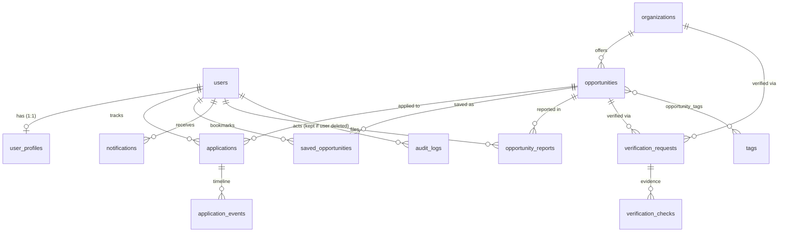

# LaunchByte — Database Guide

PostgreSQL (Supabase) via SQLAlchemy 2.0 + Alembic. **14 tables** in five groups.
Models live in `app/models/`, migrations in `alembic/versions/`.

## Entity-relationship diagram



## Tables at a glance

| Group | Table | Purpose |
|---|---|---|
| Identity | `users` | Accounts, credentials, role. **Extended** with `role`, `is_email_verified`, `last_login_at`, `updated_at`. |
| | `user_profiles` | Optional seeker details (education, skills, links). 1:1 with `users`. |
| Catalog | `organizations` | Who offers opportunities (company, university, NGO, ...). Has a verification state. |
| | `opportunities` | The postings: type, lifecycle status, dates, compensation, trust score. |
| | `tags` / `opportunity_tags` | Free-form labels, many-to-many. |
| | `saved_opportunities` | Lightweight bookmarks. |
| Tracker | `applications` | A user's tracked application. Works for platform *and* external opportunities. |
| | `application_events` | Append-only timeline: status changes, notes, interviews. |
| Trust | `verification_requests` | "Please verify this organization / opportunity." |
| | `verification_checks` | The individual signals behind a decision (domain match, registry, manual...). |
| | `opportunity_reports` | Seekers flagging scams / expired / misleading postings. |
| Platform | `notifications` | In-app messages (deadline reminders, status updates). |
| | `audit_logs` | Append-only record of staff/sensitive actions. |

## How "verification surfacing" works

```
verification_requests ──has many──▶ verification_checks   (the evidence)
        │ reviewer decision
        ▼
organizations.verification_status
opportunities.verification_status + trust_score + verified_at   ◀── what the API shows seekers
opportunity_reports (open reports can flip an opportunity to `flagged`)
audit_logs  ◀── every decision is recorded
```

`verification_status` and `trust_score` are **denormalized onto the opportunity** on purpose: the browse
page needs them on every row, and joining checks for every listing would be wasteful. The service that
records a decision must update both places in one transaction.

## Rules the database enforces (not just the app)

| Rule | Mechanism |
|---|---|
| Enum columns only hold valid values | `VARCHAR` + named `CHECK` (`ck_<table>_<column>`) |
| One account per email | unique index on `users.email` (service also lowercases it) |
| One tracked application per user per opportunity | `UNIQUE (user_id, opportunity_id)` |
| An application must point at *something* | `CHECK opportunity_id IS NOT NULL OR custom_title IS NOT NULL` |
| A verification request targets exactly one subject | `CHECK` (org XOR opportunity) |
| A user can report a posting for a given reason once | `UNIQUE (opportunity_id, reporter_id, reason)` |
| Sane ranges | `trust_score` 0-100, `priority` 1-3, `compensation_min <= max`, `starts_at <= ends_at`, `graduation_year` 1950-2100 |
| Can't delete an organization that has postings | `opportunities.organization_id` → `ON DELETE RESTRICT` |
| Can't delete an opportunity people applied to | `applications.opportunity_id` → `ON DELETE RESTRICT` (soft-delete instead: `deleted_at`) |
| Deleting a user removes their personal data | `ON DELETE CASCADE` → profile, applications (+events), bookmarks, notifications |
| Deleting a user keeps shared/moderation records | `ON DELETE SET NULL` → reports, audit logs, verification requests, posted opportunities |

## Conventions

- **UUID primary keys** everywhere (matches the existing `users.id`).
- **`created_at` / `updated_at`** are `timestamptz`, defaulted by the database (`now()`).
  `updated_at` is bumped by SQLAlchemy on ORM updates — raw SQL updates must set it manually.
- **Soft delete** (`deleted_at`) on `organizations` and `opportunities`. **Every list query must filter
  `deleted_at IS NULL`** — the database will not do it for you.
- **Ownership:** every query on `applications`, `saved_opportunities`, `notifications` must filter by the
  current user's id (`CurrentUser` in `app/dependencies/auth.py`). This is the app's authorization boundary.
- **JSON** columns are `JSONB` on Postgres. Use them for flexible lists/blobs, not for anything you filter on.
- **Emails** are stored lowercase and compared case-insensitively.

## Day-to-day commands

```bash
cd backend
alembic upgrade head                 # create / update the schema
python -m app.db.seed                # dev demo data (idempotent; refuses when ENV=production)
alembic check                        # fails if models and migrations have drifted
pytest                               # 56 tests; no Postgres required
```

### Changing the schema

1. Edit or add a model in `app/models/` (new file → import it in `app/models/__init__.py`).
2. `alembic revision --autogenerate -m "short description"`
3. **Read the generated file.** Autogenerate cannot see CHECK constraints or enum changes, and renames look
   like drop + add.
4. `alembic upgrade head` on a scratch database, then `alembic check` → "No new upgrade operations detected".
5. `pytest` — `tests/test_migrations.py` fails if models and migrations disagree.

**Adding an enum value** (e.g. a new `OpportunityType`): add it to `app/models/enums.py`, then write a
migration that drops and recreates that column's CHECK:

```python
op.drop_constraint("ck_opportunities_type", "opportunities", type_="check")
op.create_check_constraint("ck_opportunities_type", "opportunities", "type IN ('internship', ..., 'newvalue')")
```

## Supabase notes

- Set `DATABASE_URL` to the connection string from *Dashboard → Connect*, keeping the `postgresql+psycopg2://`
  prefix. URL-encode special characters in the password.
- Run **migrations over a direct or session-mode connection**, not the transaction pooler.
- **Run `docs/supabase_rls.sql` once.** Supabase exposes `public` tables through a public REST API by default;
  this script locks that door (the backend is unaffected). Re-run it after adding tables.
- Back up before migrating anything containing real data (Supabase → Database → Backups).

## Known limits (fine for small scale, revisit later)

- No full-text / fuzzy search yet — add a `tsvector` column + GIN index (or `pg_trgm`) when keyword search is built.
- No email-verification or password-reset token tables — `is_email_verified` exists but nothing sets it yet.
- `view_count` is a plain counter (racy under heavy traffic, exact enough for now).
- Enum changes need a migration (see above) — the price of DB-level validity.
